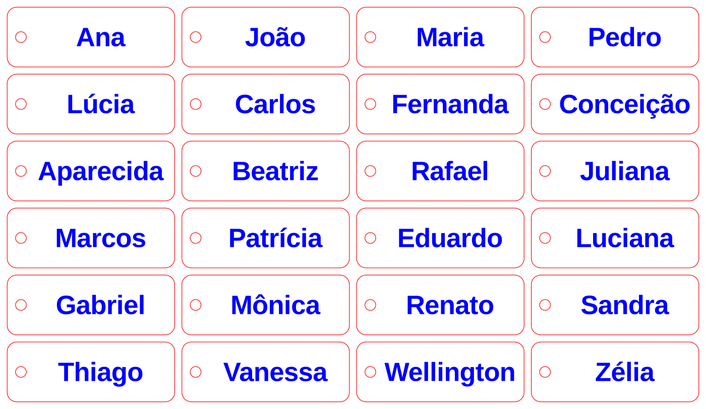
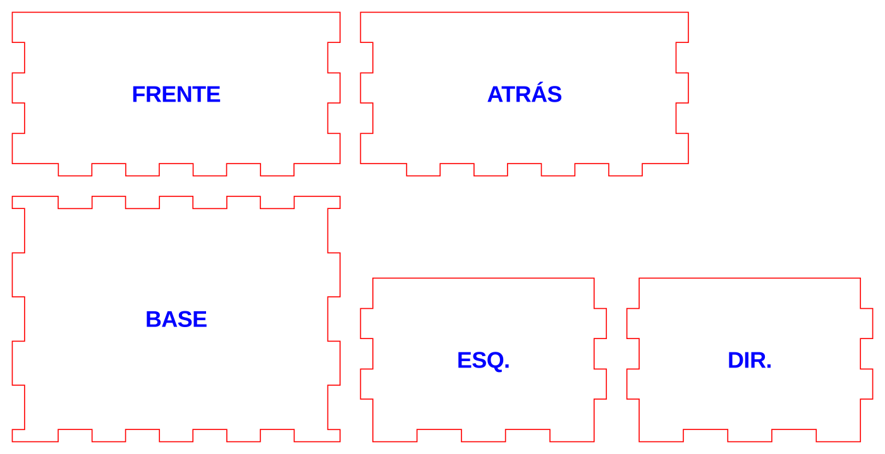
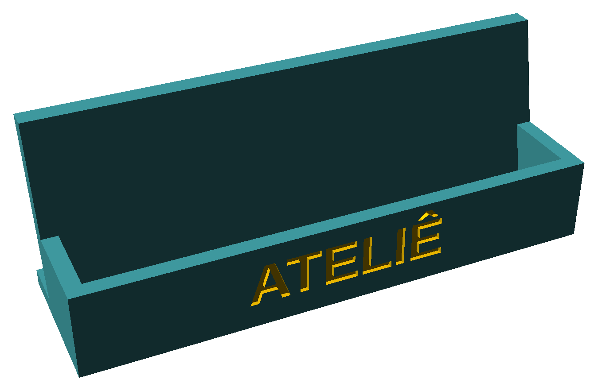
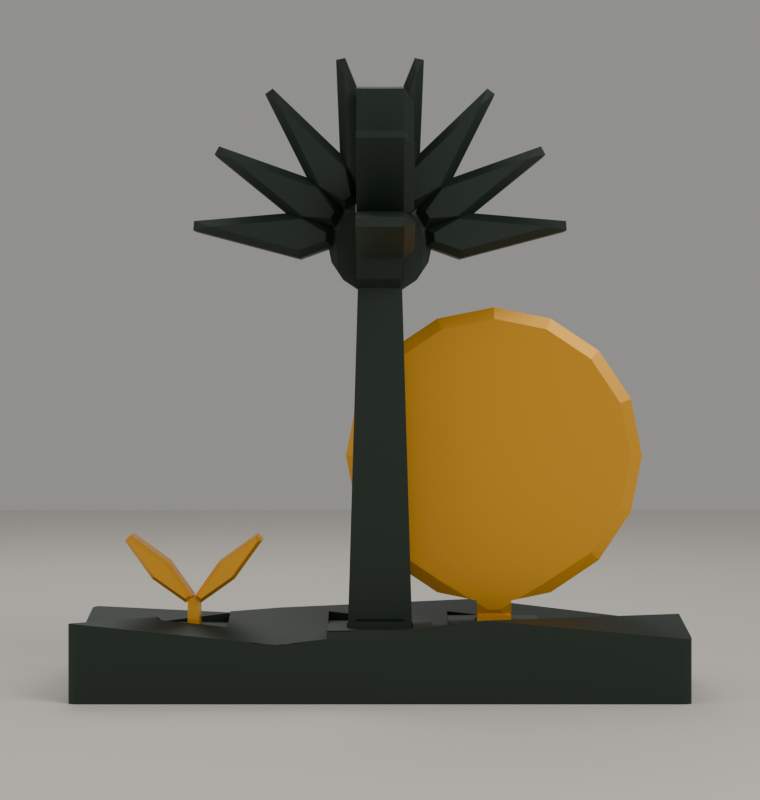
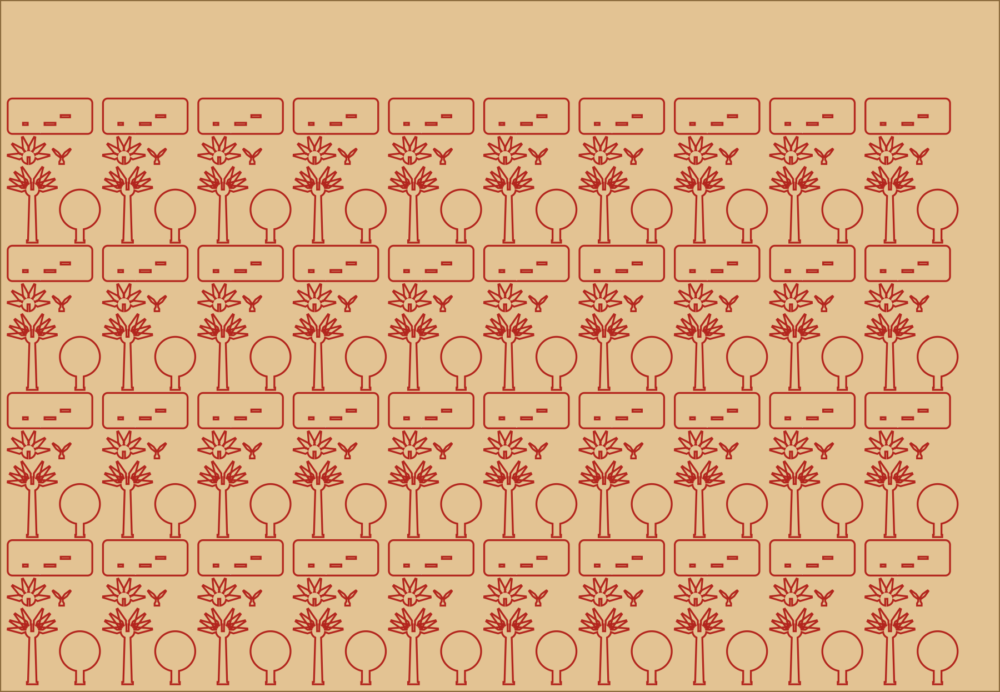

<!-- _class: lead -->
<!-- _paginate: false -->
<!-- _footer: "" -->

# Dá pra fazer

### IA e laboratório maker para gerar renda com artesanato

Thalis Antunes de Souza

I EECri 2026 · Nova Porteirinha, MG · 06/11/2026

<!--
NOTAS DO APRESENTADOR. Boa tarde, pessoal. Obrigado à organização do I EECri e aos realizadores: UFVJM, Prefeitura de Nova Porteirinha, FAVAG e FAPEMIG. E aos apoiadores: Sala Mineira do Empreendedor, Sebrae e Consórcio União da Serra Geral. Esta palestra é curta e prática. Eu vou mostrar o que dá para fazer com o laboratório e com inteligência artificial para vender artesanato, e vou contar um caso real que aconteceu há poucas semanas, com um ateliê de bordado que viu a loja na internet ser desligada e teve o prazo para salvar tudo antecipado.

TEMPO ESTIMADO. 0,5 min
-->

---

# Sou daqui do lado

- Natural de **Janaúba**, cidade irmã de Nova Porteirinha
- Fui curador do Arduino Day e do IoT Day de Janaúba
- No Latinoware desde 2011
- Ex-diretor de Design de Eventos da Campus Party Brasil
- Hoje: engenheiro, crio ferramentas para laser, 3D e bordado

<!--
NOTAS DO APRESENTADOR. Antes de tudo: eu sou de Janaúba, aqui do lado. Nova Porteirinha e Janaúba são cidades irmãs, então é bom estar em casa. Fui curador do Arduino Day e do IoT Day de Janaúba, participo do Latinoware, o congresso de software livre de Foz do Iguaçu, desde 2011, e fui diretor de Design de Eventos da Campus Party Brasil. Hoje sou engenheiro e passo boa parte do tempo criando ferramentas para corte a laser, impressão 3D e bordado. Tudo o que eu vou mostrar aqui saiu de trabalho real, não de teoria.

TEMPO ESTIMADO. 1,5 min
-->

---

<!-- _class: big -->

# Levanta a mão

- Quem aqui faz ou vende artesanato?
- Quem vende pela internet?
- Quem vende por uma plataforma só?

No Brasil, cerca de 1,3 milhão de pessoas trabalham com artesanato; 6 em cada 10 são mulheres (CRAB/Sebrae, dados da Pnad/IBGE, 2026).

<!--
NOTAS DO APRESENTADOR. Uma pergunta rápida, levanta a mão. Quem aqui faz ou vende artesanato? Quem vende pela internet? E quem vende por uma plataforma só, um único site ou aplicativo? Guardem essa última resposta, porque a gente volta nela daqui a pouco. Só para dar a medida: no Brasil são cerca de 1,3 milhão de pessoas trabalhando com artesanato, e seis em cada dez são mulheres. É muita gente, e muita renda de família.

TEMPO ESTIMADO. 0,5 min
-->

---

<!-- _class: compact -->
<!-- _header: "Dá pra fazer isso" -->

# Chaveiro com o nome de cada cliente

- A ideia do pedido: "chaveiro com o nome Maria, 70 x 25 mm, com furo"
- Assistente de IA grátis: claude.ai, ChatGPT, Gemini
- Na imagem, modelo pronto: 24 nomes, com acento
- A IA chega perto; você confere
- No arquivo: vermelho corta, azul grava

> **Dá pra vender:** lembrancinha de festa, brinde de empresa, kit de formatura.

<!--
NOTAS DO APRESENTADOR. Primeiro exemplo do "dá pra fazer". Você abre um assistente de IA, como o claude.ai, o ChatGPT ou o Gemini, que têm versão gratuita e funcionam no celular, e escreve em português mesmo, com as medidas: um chaveiro com o nome Maria, de 70 por 25 milímetros, com um furo para a argola. Na prática, antes dessa frase vai um bloco de regras, que eu passo na oficina de sábado. A IA escreve o desenho; no computador do laboratório ele vira o arquivo, e a laser corta. Quem não tem computador nem sabe por onde começar, guarda essa: no fim eu digo com quem falar. Esta chapa, com 24 chaveiros, saiu de um modelo pronto que eu preparei, não da IA, e os acentos estão todos certos: João, Conceição, Mônica. A IA chega perto, mas erra: no meu teste de 20 de outubro, com três modelos de IA, o nome Conceição saiu da peça em duas das três respostas, e nenhuma deu erro na tela. Só depois que eu deixei o pedido mais preciso é que o nome coube em todos. Por isso, quem confere é você. Quem tem menos de 18 anos usa o assistente junto com um adulto que seja o dono da conta. No arquivo, o vermelho é corte e o azul é gravação. Pensem em lembrancinha de aniversário, brinde para empresa, kit de formatura: produto personalizado em quantidade, sem desenhar um por um.

TEMPO ESTIMADO. 2,5 min
-->

---

<!-- _class: compact -->
<!-- _header: "Dá pra fazer isso" -->

# Caixa de presente, etiqueta, placa

- Caixa com encaixe: sem cola, sem prego
- Etiqueta e tag com a sua marca
- Placa gravada para loja, evento, cidade
- MDF que dobra: luminária, porta-copo

> **Dá pra vender:** embalagem que aumenta o valor da peça, porta-joias, souvenir da Serra Geral.

<!--
NOTAS DO APRESENTADOR. Segundo exemplo. Este desenho são as cinco partes da caixa, ainda abertas; cortadas, elas encaixam e viram uma caixa montada. Uma caixa com encaixe de dentes, que monta sem cola e sem prego. Vira embalagem de presente, porta-joias, caixa de kit. Embalagem bonita aumenta o valor do que vai dentro. Etiqueta e tag com a sua marca: o Diego me contou de artesão que precisa de etiqueta e não sabe fazer, e nem precisa saber, é só pedir no laboratório. Placa gravada para loja, para evento, para a cidade. E um truque bonito: um padrão de cortes que deixa o MDF dobrar, para luminária e porta-copo. Tudo isso dá para fazer numa laser como a do laboratório que está aqui.

TEMPO ESTIMADO. 1,5 min
-->

---

<!-- _class: compact -->
<!-- _header: "Dá pra fazer isso" -->

# Impressão 3D: peça com volume e cor

 

**Porta-cartão da banca:** o nome da loja gravado na frente; trocar o nome é mudar uma linha do arquivo

**Lembrancinha de evento:** 5 peças, verde e dourado; cerca de 1h25 e 54 g de filamento por lembrancinha

> **Dá pra vender:** brinde com o nome da loja, lembrancinha de festa.

<!--
NOTAS DO APRESENTADOR. Agora a impressora 3D, que faz o que a laser não faz: peça com volume e com cor. Dois exemplos que eu desenhei. À esquerda, um porta-cartão para a banca de feira ou o balcão da loja: cabe o cartão de visita comum, de 9 por 5 centímetros, e na frente vai gravado o nome da loja. Para trocar "Ateliê" por "Doces da Ana", muda-se uma linha do arquivo. É a peça que a turma de sábado aprende a fazer. À direita, uma lembrancinha que eu desenhei para um encontro de ex-alunos em 2026: uma palmeira do cerrado, um sol e um broto encaixados numa base. São 5 peças, em verde e dourado, impressas separadas e coladas. O fatiador, que é o programa que prepara a peça para a impressora, calcula cerca de uma hora e 25 minutos de máquina e 54 gramas de filamento por lembrancinha; filamento é o fio de plástico que a impressora derrete, camada por camada. Ainda não imprimimos: por enquanto é o desenho e a conta. Pensem em brinde com o nome da loja, lembrancinha de festa, peça com as cores da sua marca.

TEMPO ESTIMADO. 1,5 min
-->

---

<!-- _class: compact -->
<!-- _header: "Dá pra fazer isso" -->

# Faça a conta

| 65 unidades | 3D | Laser |
| --- | --- | --- |
| Material | 4 rolos de filamento | 2 chapas de compensado |
| Máquina ligada | cerca de 93&nbsp;h* | cerca de 2,5 h* |
| Montagem | colar as peças | encaixar; cola só nas abas |

> **Mesma peça, duas máquinas:** a 3D dá volume e cor; o laser dá velocidade no lote.

Planejado, ainda não produzido. *Estimativas. Ao lado: 40 lembrancinhas numa chapa.

<!--
NOTAS DO APRESENTADOR. E aqui vem a lição que eu mais queria trazer. Depois de desenhar a lembrancinha para a impressora, eu desenhei a mesma peça de novo, para a laser: cinco peças planas de compensado de 3 milímetros, que se encaixam; só as abas da base levam um pingo de cola. Aí eu fiz a conta para 65 unidades. Na impressora 3D: 4 rolos de filamento, 3 verdes e 1 dourado, e cerca de 93 horas de máquina ligada, divididas em duas impressoras, mais uns 2 minutos de cola por lembrancinha. Na laser: duas chapas de compensado, porque cada chapa leva 40 lembrancinhas, como nesta imagem, e cerca de duas horas e meia de corte e gravação. Esse tempo da laser é estimativa, sem contar trocar a chapa e acertar o foco; mesmo que dobre, é uma tarde de laser contra dias de impressora. Uma máquina não é melhor que a outra: a 3D dá volume e cor; o laser dá velocidade no lote. Quem decide é a conta, e ela se faz antes de ligar a máquina. E um aviso honesto: isso é planejamento, nada foi produzido ainda.

TEMPO ESTIMADO. 1,5 min
-->

---

<!-- _class: compact -->
<!-- _header: "O que vem aí" -->

# Bordado: do nome ao arquivo da máquina

- O cliente digita o nome, escolhe a letra e a cor, e vê a prévia
- O sistema gera o arquivo que a máquina de bordar lê
- Num teste desse caminho: 5 segundos do nome ao arquivo
- Ainda em teste: nada bordado com ela

> **Aprendizado:** "João" virou "Jo o", sem aviso. A máquina ajuda; quem confere é você.

<!--
NOTAS DO APRESENTADOR. Último exemplo, e este ainda está em teste: o bordado, que é o assunto do caso que eu vou contar. Estou montando com o ateliê uma ferramenta própria: o cliente digita o nome, escolhe a letra, que é o tipo de fonte do bordado, e a cor, vê a prévia, e o sistema gera o arquivo que a máquina de bordar computadorizada lê, como um arquivo de pendrive. Por baixo ela usa o Ink/Stitch, um programa livre e gratuito de bordado. Num teste desse caminho, do nome ao arquivo levou 5 segundos. Ainda não bordamos com ela numa máquina de verdade, isso vem agora. E um aprendizado: só 40 das 142 letras do Ink/Stitch têm todos os acentos do português. Numa das letras que testamos, João virou "Jo o", sem nenhum aviso: o programa trocou a letra e não avisou. A máquina ajuda; quem confere é você.

TEMPO ESTIMADO. 2 min
-->

---

<!-- _header: "Caso real" -->

# Um ateliê de bordado

- Bordado personalizado: toalha, pano de prato, enxoval de bebê, necessaire, sacola
- **566 anúncios** no Elo7
- Preços de R$ 15 a R$ 360; metade custa até R$ 35
- Quase metade feita sob encomenda

<!--
NOTAS DO APRESENTADOR. Agora o caso real. É um ateliê de bordado com quem eu trabalho. A artesã borda toalha, pano de prato, enxoval de bebê, necessaire, sacola. Vendia no Elo7, um site de venda de artesanato, desde 2023. Eram 566 anúncios no painel, contando os esgotados. Os preços vão de 15 a 360 reais, e metade custa até 35. Quase metade é feita sob encomenda, a maioria com prazo de 10 dias úteis. Um negócio de verdade, com catálogo grande, fotos e clientes. E aí veio o problema.

TEMPO ESTIMADO. 1,5 min
-->

---

<!-- _header: "O problema" -->

# A vitrine fechou

- Era de uma empresa grande e parecia sólido
- Maio de 2026: parou de vender
- **20/10/2026: desligou de vez**
- Não levava o catálogo; fotos, só uma por uma

> **A plataforma decide; você obedece.** Milhares de vendedores perderam o canal.

<!--
NOTAS DO APRESENTADOR. O Elo7 parecia sólido: já tinha sido comprado por uma gigante americana, o Etsy, e depois pelo Enjoei. Em maio deste ano o Enjoei encerrou as vendas, porque a receita do fim de 2025 tinha caído 39,5% em relação ao fim de 2024. A ajuda do site dava até 7 de novembro para consultar fotos e descrições, mas o prazo foi antecipado. E no dia 20 de outubro o site foi desligado de vez. O aviso dizia: "no dia 20 de outubro, o site do Elo7 vai ser desativado completamente". A plataforma não levava o catálogo para lugar nenhum e não deixava baixar as fotos em lote, só uma por uma. Quem não salvou perdeu fotos, textos e avaliações.

TEMPO ESTIMADO. 1,5 min
-->

---

<!-- _header: "O problema · 20/10/2026" -->

# 392 produtos no contador. 1 na vitrine.

- **No alto da loja:** o contador diz 392 produtos
- **Na lista, logo abaixo:** 1 produto, uma toalha de R$ 82, sem a foto
- **No painel da artesã:** 566 anúncios, contando os esgotados

Loja do ateliê no Elo7, 20/10/2026, último dia no ar. A captura de tela não faz parte da versão pública.

<!--
NOTAS DO APRESENTADOR. Assim estava a loja do ateliê no último dia. Lá em cima, o contador diz 392 produtos; no painel da artesã eram 566 anúncios, contando os esgotados. Logo embaixo, a lista mostra um produto só, uma toalha de 82 reais, e nem a foto carrega. Anos de trabalho desde 2023, de fotos, de descrições, de avaliações de clientes, sumindo da tela. Agora voltem lá na pergunta do começo: quem vende por uma plataforma só. É isso que pode acontecer. Não por culpa sua, mas por uma decisão que alguém tomou numa sala de reunião bem longe daqui.

TEMPO ESTIMADO. 1 min
-->

---

<!-- _header: "O resgate · 19/10/2026" -->

# O resgate: uma noite, um robô

- Um "robô" no próprio navegador da artesã lê a loja e copia tudo para o computador
- Só lê; não altera nada
- **566 anúncios e 1.572 fotos salvos em 23 minutos**
- Junto: pedidos, clientes e páginas da loja

> **Lição:** seu catálogo é seu patrimônio. Guarde uma cópia, sempre.

<!--
NOTAS DO APRESENTADOR. Na véspera do desligamento, 19 de outubro, a gente correu. Fizemos um pequeno programa, um robô, que roda no navegador da própria artesã, entra na loja dela e vai copiando tudo para o computador. Ele só lê, não altera nada. Em 23 minutos, entre nove da noite e nove e meia, ele salvou os 566 anúncios com título, descrição, preço, prazo e medidas, e 1.572 fotos. Salvou também os pedidos, os clientes e as páginas da loja. A lição é simples: o seu catálogo é o seu patrimônio. Guarde uma cópia, sempre, antes de precisar.

TEMPO ESTIMADO. 1,5 min
-->

---

<!-- _class: compact -->
<!-- _header: "A virada" -->

# A loja própria

**A loja do ateliê, com endereço próprio**

- No ar em cerca de 5 horas, na mesma noite
- Servidor próprio e softwares livres (programas gratuitos)
- Sem mensalidade de plataforma: só a anuidade do domínio (o endereço do site, pago uma vez por ano)
- Encomenda pelo WhatsApp; o pagamento no site vem em seguida

Etiqueta, tag e embalagem da sua loja saem do laboratório: procure o Diego.

<!--
NOTAS DO APRESENTADOR. Na mesma noite, a loja própria do ateliê entrou no ar. Do primeiro levantamento, às seis e meia da tarde, até a loja aberta, às onze e meia, foram cerca de 5 horas. Ela roda num servidor próprio, com programas livres, WordPress e WooCommerce, que qualquer um pode usar sem pagar licença. Não tem mensalidade de plataforma; o custo fixo é a anuidade do domínio. Os anúncios e as fotos entraram: 565 estão no ar, separados em 6 categorias, e 1 ficou guardado porque tinha um nome próprio no título. Por enquanto a cliente escolhe a peça e encomenda pelo WhatsApp; o pagamento no site vem em seguida. Traduzindo: domínio é o endereço do site, que se paga uma vez por ano; software livre é programa que qualquer um pode usar sem pagar. Eu fiz isso numa noite porque é o meu trabalho; vocês não precisam fazer sozinhos, e no fim eu digo por onde começar. E a loja nova também precisa de etiqueta, tag e embalagem: tudo isso pode sair do laboratório.

TEMPO ESTIMADO. 2,5 min
-->

---

<!-- _class: compact -->
<!-- _header: "Por que ter a sua" -->

# Por que ter a sua casa na internet

| Toalha bordada de R$ 82,00 | Valor |
| --- | --- |
| Taxa num marketplace (exemplo: Shopee, 14% + R$ 16) | R$ 27,48 |
| Quanto da venda vai embora | cerca de 1/3 |
| Na loja própria, com encomenda pelo WhatsApp | sem taxa de plataforma; só a anuidade do domínio (e a hospedagem, se não tiver servidor próprio) |

- Marketplace (site que vende de vários lojistas, como a Shopee): vitrine extra, nunca a única
- Loja própria: a sua casa, com o seu catálogo
- WhatsApp e Instagram: a conversa com o cliente

<!--
NOTAS DO APRESENTADOR. E tem uma razão de dinheiro também. Marketplace é aquele site que junta a venda de muitos lojistas, como a Shopee e o Mercado Livre. Um exemplo, com a tarifa da Shopee que usamos no planejamento da loja do ateliê, 14% mais 16 reais: uma toalha bordada de 82 reais paga 27 reais e 48 centavos de taxa. A tarifa pode mudar, então confira a de hoje antes de fazer a sua conta. Um terço do preço fica com a plataforma. Não estou dizendo para sair de todas. Marketplace é bom como vitrine extra, para ser encontrado. Mas a casa, onde fica o seu catálogo e o contato dos seus clientes, tem que ser sua. E a conversa com o cliente, no WhatsApp e no Instagram. Na loja própria não tem essa taxa. O custo fixo é a anuidade do domínio; quem não tem servidor próprio paga também a hospedagem, que é o aluguel do computador onde o site fica. E quando entrar o pagamento no site vai ter a taxa do Pix ou do cartão. Uma plataforma de lojas virtuais escreveu, depois do fim do Elo7, uma frase que vale para todo mundo: não dependa de um único canal que você não controla.

TEMPO ESTIMADO. 1,5 min
-->

---

<!-- _class: big -->
<!-- _header: "A IA, com honestidade" -->

# Onde a IA ajudou, e onde ainda não

**Ajudou:** a arrumar os 566 anúncios numa noite

**Errou:** ao classificar produtos pela foto, 8 de 15 certos

> **Regra:** teste antes de acreditar. A IA faz o rascunho; a decisão é sua.

<!--
NOTAS DO APRESENTADOR. Agora, com honestidade. Onde a IA ajudou de verdade: numa noite, ela ajudou a montar seis relatórios de pesquisa, com a fonte de cada informação: plataformas de loja, atendimento, pagamento, bordado. Ajudou a arrumar os 566 anúncios: letras quebradas e 79 palavras de busca grudadas, como "panodeprato", foram corrigidas; outras 19 ainda esperam a revisão da artesã. E o primeiro rascunho do desenho de uma peça para laser ou 3D sai na hora, a partir de uma frase. Onde ainda não provou: testamos uma IA instalada no próprio computador criando o anúncio a partir das fotos do produto. Em 15 produtos, ela acertou o tipo de peça em 8; um método mais simples, que só procura produtos parecidos, acertou 11. A amostra é pequena e ainda não dá para dizer qual é melhor. E nos pedidos de desenho: no primeiro teste, com dois modelos da Claude, 6 das 10 primeiras respostas tinham defeito; depois de ajustar o pedido, as 5 respostas da segunda rodada passaram. No teste de 20 de outubro, com três modelos e os pedidos da oficina, 19 de 24 respostas passaram na primeira rodada, e o nome comprido com acento saiu da peça em 2 de 3. Depois de deixar o pedido mais preciso, o nome coube em todos os modelos que testei, inclusive em versões do ChatGPT e do Gemini que não são os aplicativos gratuitos. Os aplicativos gratuitos que vocês vão usar no celular não foram testados desse jeito. Teste antes de acreditar.

TEMPO ESTIMADO. 2 min
-->

---

<!-- _header: "Ferramentas" -->

# Ferramentas que eu desenvolvo

Eu faço as **pontes** que deixam a IA desenhar para a laser e para a impressora 3D.

Três estão abertas e de graça no meu GitHub (site onde se guardam e compartilham programas), para os alunos do IF e quem quiser:

- **github.com/thalisantunes/mcp-openscad**: peça para laser e 3D
- **github.com/thalisantunes/mcp-freecad**: confere a peça 3D
- **github.com/thalisantunes/mcp-kicad**: placa eletrônica

Licença MIT: pode usar e modificar.

<!--
NOTAS DO APRESENTADOR. As ferramentas que eu uso, eu mesmo desenvolvo. Pensem nelas como pontes: a IA sabe conversar, mas não sabe mexer na máquina; a ponte deixa a IA desenhar a peça em milímetros e entregar o arquivo para a laser ou para a impressora 3D. Três estão abertas, de graça, no meu GitHub, que é um site onde se guardam e compartilham programas. Para os estudantes, os endereços estão na tela. Para a artesã, basta saber que isso existe e que o laboratório é o lugar para usar. Tenho também ferramentas próprias, ainda privadas, como o gerador de bordado que mostrei.

TEMPO ESTIMADO. 1 min
-->

---

<!-- _class: compact -->
<!-- _header: "A partir de amanhã" -->

# Primeiros passos

**Se você é artesã ou artesão**
1. Salve hoje uma cópia das suas fotos e descrições
2. Use WhatsApp e Instagram para atender e divulgar; quando der, tenha loja própria
3. Use a IA no trabalho chato: texto do anúncio, legenda, etiqueta

**Se você é estudante**
1. Escolha um produto e escreva em uma frase o que ele precisa ter
2. Peça à IA o desenho em código OpenSCAD (versão gratuita serve) e confira a medida
3. Corte no laboratório e venda o primeiro lote

<!--
NOTAS DO APRESENTADOR. Para sair daqui com alguma coisa. Se você é artesã ou artesão: hoje mesmo, salve uma cópia das suas fotos e descrições, no computador ou num pendrive. Use o WhatsApp e o Instagram para atender e divulgar, mas lembre que eles também são de outra empresa: a cópia do catálogo fica com você. E, quando der, tenha uma loja própria. E use a IA no trabalho chato, o texto do anúncio, a legenda, a etiqueta. Se você é estudante: escolha um produto, escreva em uma frase o que ele precisa ter, peça a um assistente de IA, a versão gratuita serve, o desenho em código do OpenSCAD, um programa gratuito que transforma esse código num desenho com medidas. Confira a medida e corte no laboratório. O pedido que funciona leva antes um bloco de regras; se travar, leve a ideia ao Diego antes de insistir com a IA. Quem tem menos de 18 anos usa o assistente com um adulto dono da conta. Os minicursos de laser e de 3D deste evento são esse caminho.

TEMPO ESTIMADO. 2 min
-->

---

<!-- _class: cta -->
<!-- _paginate: false -->

# Procure o Diego

no **Laboratório Maker de Nova Porteirinha**

Ele monta com você, **de graça**, um planejamento para o seu caso,
seja você empreendedor ou estudante.

Fale com ele aqui no evento ou no Laboratório Maker.
Você nem precisa saber fazer: é só pedir.

<!--
NOTAS DO APRESENTADOR. E o recado mais importante da tarde: procure o Diego, do Laboratório Maker de Nova Porteirinha. Ele está aqui no evento: fale com ele depois desta palestra, ou procure ele no Laboratório Maker. Ele monta com você um planejamento para o seu caso, e isso é de graça. Se você é artesã e quer uma etiqueta, uma embalagem, uma peça nova. Se você é estudante e quer transformar uma ideia em produto. E você nem precisa saber operar a máquina: tem coisa que é só pedir. Dá pra fazer isso, isso e isso. Procura o Diego.

TEMPO ESTIMADO. 1,5 min
-->

---

<!-- _class: lead encerramento -->

# Obrigado. Perguntas?

**Procure o Diego no Laboratório Maker**

Hoje, 20h30: mesa **"O Futuro da Economia Criativa na Serra Geral"**
Sábado: turma fechada de IA para 3D e laser (fale com o Diego)

<!--
NOTAS DO APRESENTADOR. Obrigado. Hoje à noite, às 20h30, tem a mesa "O Futuro da Economia Criativa na Serra Geral": um bate-papo para pensar os próximos passos. E no sábado o Laboratório Maker tem uma turma fechada e pequena, de IA para 3D e laser; as vagas são poucas, e quem diz se cabe mais alguém é o Diego. E lembrem: o primeiro passo é procurar o Diego. Agora, perguntas: quem começa?

TEMPO ESTIMADO. 1 min
-->
